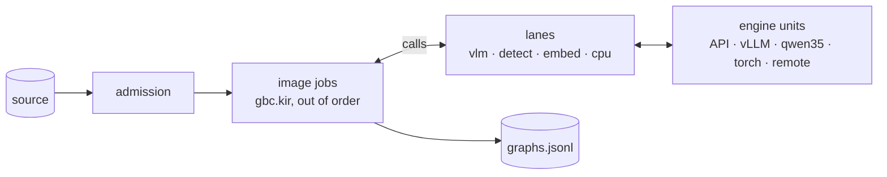
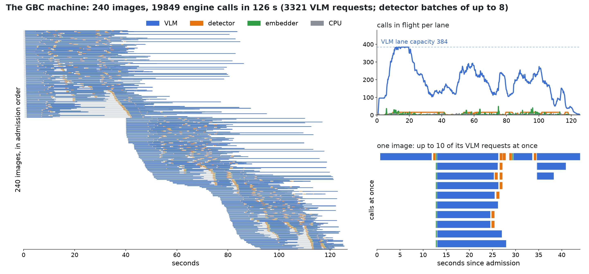

# KohakuGBC

[English](README.md) | **简体中文**

[](https://arxiv.org/abs/2407.06723)
[](https://github.com/apple/ml-gbc)


项目把基于图的图像描述（Graph-Based Captioning，[GBC](https://arxiv.org/abs/2407.06723)）实现为运行在 [Togeari](https://github.com/KohakuBlueleaf/Togeari) 数据流机器上的单个 [KIR](https://github.com/KohakuBlueleaf/KohakuNodeIR) 程序，并提供执行所需的引擎：通过 OpenAI 兼容或 Anthropic API 调用的 VLM、进程内 vLLM 或专用 Qwen3.5 引擎；用于检测的 OWLv2 或 SAM 3；用于名称嵌入的 EmbeddingGemma。可部署于单 GPU、多 GPU 或其他节点。

生成一个 GBC 图是一个不断分支的过程：让 VLM 描述图像、检测它命名的对象、描述各个区域、检测区域内的组成部分、合并表示同一对象的区域，再询问关系问题。每张图像对应的控制流程都不同，因此无法简单地人工安排跨图像批处理。KohakuGBC 将这一过程编写为顺序的 KIR 程序；Togeari 则同时执行多张图像，重叠执行顺序程序无法预先区分的调用，并把模型请求汇总为批量引擎调用。


**目录：** [亮点](#亮点) · [安装](#安装) · [快速开始](#快速开始) · [工作原理](#工作原理) · [配置](#配置) · [输出](#输出) · [与原版-gbc-保持一致](#与原版-gbc-保持一致) · [性能实测](#性能实测) · [仓库结构](#仓库结构) · [详细文档](#详细文档) · [测试](#测试)

## 亮点

- **大规模运行 GBC，模型由你选择。** 可通过托管 API、自己的 vLLM 或 SGLang 服务器，或在本地单进程 GPU 环境中处理数千至数百万张图像；其他节点的引擎也能加入同样的通道。
- **严格保持顺序过程的语义。** 每个任务均可录制并在 KIR 参考解释器中回放。对录制的 GBC 概念验证（PoC）运行，所有图的摘要均与原版一致。
- **将过程参数表示为数据。** 根节点模式（图像查询、已有描述、标签）、节点数量预算、分支数量及关系问题都可以通过每图像的 `controls` 指定；检测器本身只是一个配置选项。
- **统一的引擎契约。** 从 HTTP 服务到为此工作负载开发的 qwen35 引擎，全部都实现 Togeari 的接口，并接受一致性检查。

## 安装

```
pip install kohakugbc                 # 程序、执行机器、API 与回放引擎
pip install "kohakugbc[torch]"        # 使用 torch 的检测器（OWLv2、SAM 3）与嵌入模型
pip install "kohakugbc[vllm]"         # 通过 vLLM 在进程内运行 VLM（Linux）
pip install "kohakugbc[qwen35]"       # qwen35 VLM 引擎（Windows、Linux）
```

Wheel 包包含 Rust 扩展 `kohakugbc._rs`（图解析）。如果从源代码克隆安装，则需要 Rust 工具链：

```
git clone https://github.com/KohakuBlueleaf/KohakuGBC && cd KohakuGBC
uv venv -p 3.13
uv pip install -e ".[torch,dev]"      # 根据显卡驱动选择匹配的索引安装 torch
uv pip install -e ".[torch,qwen35,dev]"
gbc doctor
```

`gbc doctor` 打印版本、设备及可用内存、每个槽位的所有引擎入口；传入配置层后还会输出部署规划以及内存是否足够。

## 快速开始

**单 GPU 模式**：在同一进程运行 VLM、检测器和嵌入模型（`configs/machine/qwen35_local.py`：Qwen3.5-4B 使用 qwen35 引擎、OWLv2、在 CPU 上的 EmbeddingGemma；示例配置面向 24 GiB 显存）：

```
GBC_IMAGES=path/to/images gbc run configs/machine/qwen35_local.py
# SAM 3 as the detector (illustrations):
GBC_IMAGES=path/to/images gbc run configs/machine/qwen35_local.py configs/machine/qwen35_sam3_local.py
```

每张图像生成一个图，保存到 `runs/machine/qwen35_local/graphs.jsonl`。上方预览图即对应其源图像的 GBC 图（共 29 个顶点，图中显示 20 个；51 条边、48 条描述），由 `scripts/docs/teaser.py` 绘制：

```
{"vertices":[{"vertex_id":"","bbox":{"left":0.0,"top":0.0,"right":1.0,"bottom":1.0,"confidence"
:null},"label":"image","descs":[{"text":"An anime-style illustration depicts a young girl with
blonde hair and fox-like ears sitting on a weathered wooden window sil ...
```

**通过 API 模式**：VLM 在服务器上运行（vLLM、SGLang、llama.cpp、OpenAI、OpenRouter、Anthropic），视觉模型在本机运行：

```python
# my_run.py
engines = {
    "vlm": {
        "entry": "api",
        "protocol": "openai",
        "flavour": "vllm",
        "model": "Qwen/Qwen3.5-4B",
        "endpoints": [{"base_url": "http://10.0.0.5:8000/v1", "max_inflight": 64}],
        "metrics": "vllm",
    },
    "detect": {"entry": "torch", "model": "facebook/sam3", "dtype": "bfloat16"},
    "embed": {"entry": "torch", "devices": ["cpu"]},
}
source = {"kind": "folder", "path": "images"}
sink = {"kind": "graphs", "path": "runs/my_run/graphs.jsonl"}
machine = {"report": "runs/my_run/report"}
```

```
gbc check my_run.py      # 构建机器但不启动引擎，集中输出所有配置问题
gbc run my_run.py
```

**无需模型**：通过伪引擎回放 PoC 的录制运行，同时运行程序与执行机器；生成的每个图都与 PoC 一致：

```
gbc run configs/machine/replay_text.py
```

**通过 Python 使用：**

```python
from kohakugbc.machine import build

machine, source, sink = build(
    "configs/machine/qwen35_local.py", {"source": {"kind": "folder", "path": "images"}}
)
with machine:
    machine.run(source, sink)
```

| 命令 | 作用 |
|---|---|
| `gbc run CONFIG [CONFIG ...]` | 合并配置层，构建执行机器并将数据源处理到输出端 |
| `gbc check CONFIG ...` | 构建并验证机器，不启动任何执行单元 |
| `gbc host CONFIG ... --slot S --listen HOST:PORT` | 为其他节点提供槽位 S 的执行单元 |
| `gbc doctor [CONFIG ...]` | 显示版本、设备、引擎入口和配置的部署规划 |

## 工作原理

| 层次 | 软件包 | 负责内容 |
|---|---|---|
| GBC 程序 | `kohakugbc.program`、`kohakugbc.nodes`、`kohakugbc.graph` | `gbc.kir`（单张图像任务）、`gbc` 节点库、控制项、记录和图解析（Python 参考实现，以及 `kohakugbc._rs` 中按摘要一致的 Rust 实现） |
| GBC 执行机器 | `kohakugbc.machine`、`kohakugbc.io` | 在 Togeari 上执行程序：各引擎槽位的通道、绑定、准入、输入源、输出端、配置层 |
| GBC 引擎 | `kohakugbc.engines`、`kohakugbc_models` | 各槽位的引擎入口、部署规划、跨节点引擎、无需模型的回放引擎 |

### GBC 图

一个 GBC 图使用有向无环图（DAG）描述一张图像。图像顶点携带简短和详细描述；描述中命名的对象构成实体顶点，各自拥有描述和边界框；其组成部分位于下层；组合顶点负责安排同一对象的多个实例；关系顶点则描述对象之间的关系。

每条边同时由三个方面定位：它是图中的一条边；它的标签是父顶点描述中的一个短语；子顶点的边界框位于父顶点框内。

### 程序：单张图像任务


根节点描述整张图像并检测描述中提及的对象。每一轮将当前等待处理的区域作为独立工作项（检查是否已见过该对象，描述该区域，找出其组成部分），发现的新部分进入下一轮的待处理队列。

随后根据控制条件选择：深入一层再执行一轮；询问 VLM 图像中还有哪些没有被覆盖的对象并加入；或者结束并询问关系问题。

流程图中标有 ×? 的步骤会按回复命名的对象数量生成对应数量的工作项；执行多少轮也取决于运行时结果。因此每张图像都具有自己的动态工作流：有的图像只发出 3 次 VLM 请求，有的超过 30 次。若按照固定阶段对不同图像统一批处理，就必须等待最慢的图像；相反，执行机器会在输入就绪时立即运行各工作项，并把所有图像中可执行的调用合并处理（`scripts/docs/workflow.py`）。

`gbc.kir` 是普通的顺序程序，其顶层结构如下：

```
@def (image, captions = None, tags = None, controls = None)gbc(graph, stats):
    (image, captions, tags, controls)root(records, found)      # the image vertex, what it names
    ...
    decide:
        (records, frontier, rounds, breadth, stop, controls)next_step(step)
        (step)switch("depth"=>`depth`, "breadth"=>`widen`, _=>`done`)
        widen:                                                 # one more root sentence
            (image, records, controls)coverage(records, found, grew)
        depth:                                                 # one round of regions
            (image, frontier, records, seen, controls)depth_round(frontier, records, seen)
        done:
    (image, records, controls)relate(records)                  # relations, compositions
    (image, records, controls)to_gbc(graph, stats)             # records to the GBC graph
```

| `@def` | 作用 |
|---|---|
| `root` | 图像顶点：GBC 图像查询，或已有描述（纯文本、图文、标签） |
| `detect` | 在父边界框内检测已命名实体的位置，进入下一层 |
| `expand` | 处理一个区域：根据名称嵌入相似度和框重叠判断是否与已有顶点表示同一对象；若是则合并，否则进行描述并检测组成部分 |
| `wave`、`depth_round` | 一轮处理：以开始时的待处理队列为基础，分批处理节点预算内的区域；一批中的区域并行运行 |
| `coverage` | 追加根描述句，命名尚未覆盖的对象 |
| `relate` | 对图发出关系和组合问题 |
| `ask` | VLM 请求；失败时返回空回复，与 GBC 的处理方式一致 |

模型调用节点（`chat`、`detector`、`embedder`）只负责传输；请求构造和回复解析由普通节点完成，因此各引擎都执行相同的请求与解析过程。

### 控制参数

每个任务的输入包含决定图中应有哪些内容的控制项；配置层的 `controls` 为其提供默认值，但每个任务自身的控制项优先。

| 控制项 | 默认值 | 含义 |
|---|---|---|
| `root` | `query` | `query`（VLM 直接描述图像）、`text` / `image_text`（从已有描述构建）、`tags`（从标签构建） |
| `min_nodes`、`max_nodes`、`max_rounds` | 8、20、4 | 图像与实体顶点数量预算；达到最大轮数后停止，低于最小节点数时进行广度补充 |
| `max_top_level`、`max_features_per_entity`、`max_instances_per_text`、`max_depth` | 6、4、6、3 | 扩展分支的数量上限及深度上限 |
| `round_size`、`priority`、`max_breadth_rounds`、`coverage_max_new` | None、`area_depth`、1、4 | 每轮处理的区域数及排序方式；覆盖补充轮次 |
| `entity_batch`、`leaf_caption` | 1、`query` | 每次 VLM 请求包含的区域数；叶节点由独立请求还是父节点回答生成描述 |
| `relational`、`relate` | `both`、`end` | 询问哪类关系问题；在最后统一询问还是每轮后询问 |
| `max_side` | 1568 | 发给 VLM 的图像最长边缩放到的像素数 |
| `same_threshold`、`overlap_threshold` | 0.725、0.85 | 判断是否同一对象的名称嵌入相似度阈值与边界框重叠阈值 |
| `tag_threshold`、`tag_hint` | 0.35、False | 种子根节点中的标签作为元素的阈值；是否在实体提示词中提供标签 |

### 执行机器



Togeari 像乱序 CPU 核心执行线程一样运行每张图像任务：一旦输入齐备，语句就能发出；某个分支的条件仍在判断时，后续不依赖它的代码可以提前执行；`parallel` 和 `each` 可以扩展工作项；最后执行窗口按程序顺序提交结果，保证与顺序执行完全相同。

跨任务时，同类模型调用汇入同一通道：检测通道能把多张图像的裁剪区域聚合成一次前向计算，VLM 通道则尽可能保持各单元的队列饱满。



该图根据执行事件日志由 `scripts/docs/machine_view.py` 绘制：30 张录制图像在回放引擎上按照录制延迟运行。左侧每行是一张图像，每个色块是所在引擎通道的一次调用，不同图像交错复用共享引擎。右侧展示 VLM 通道在最后几张图像结束前始终保持容量 32；同一张图像也能同时存在最多 10 条 VLM 在途请求。

| 槽位 | 节点 | 通道类型 | 入口 |
|---|---|---|---|
| `vlm` | `chat` | 流式单元 | `api`、`vllm`、`qwen35`（`qwen35` extra）、`replay`、`remote` |
| `detect` | `detector` | 批处理单元 | `torch`（OWLv2 或 SAM 3）、`replay`、`remote` |
| `embed` | `embedder` | 批处理单元 | `torch`（EmbeddingGemma）、`replay`、`remote` |
| `cpu` | 裁剪、图像处理、解析、图生成 | 工作线程池 | `python`（线程或进程）、`remote` |

任务准入保持 VLM 通道的目标负载（`vlm_waiting`）：只有当通道队列和单元等待数低于目标时，新图像才会进入。每个槽位的入口只选择一次。部署规划则汇总每台设备上各引擎所需的内存；如果超过可用内存，会在模型权重加载前拒绝启动。

### 引擎

| 入口 | 槽位 | 运行方式 | 说明 |
|---|---|---|---|
| `api` | vlm | 任意 OpenAI 兼容服务器或 Anthropic Messages API，每端点一个单元 | `flavour` 决定 JSON Schema 的放置方式并按服务类型关闭 Qwen3.5 思考；支持限流、健康检查、`X-GBC-Request` 摘要 |
| `vllm` | vlm | 本进程内 vLLM `AsyncLLM`，每设备组一个单元 | 单元内跨设备张量并行；部署规划会计算其显存预留 |
| `qwen35` | vlm | 专为此工作负载编写的 Qwen3.5 引擎（[kohakugbc_models/vlm/qwen35](src/kohakugbc_models/vlm/qwen35/README.zh-CN.md)） | 状态槽与分页 KV 上的打包混合步骤、前缀快照、Triton 内核与参考实现计时竞速、解码 CUDA 图、xgrammar 遮罩及强制 token 跳跃、独立视觉处理阶段 |
| `torch` | detect | OWLv2（`google/owlv2-base-patch16-ensemble`，与 PoC 相同）或 SAM 3（`facebook/sam3`） | 每设备一个单元；OWLv2 使用 float16、批大小 1 时能完全复现 PoC 的检测框 |
| `torch` | embed | EmbeddingGemma | 批量计算并归一化 |
| `python` | cpu | Togeari 的 Python 工作者 | 线程或进程 |
| `remote` | 任意 | 由其他节点的 `gbc host` 提供单元 | 通道将其视作本地单元 |
| `replay` | 任意 | 利用录制轨迹及原始延迟返回答案 | 可在不加载模型时运行程序和机器 |

**插画图像中的检测。** 对一幅动漫风格肖像，OWLv2（PoC 原版检测器）对“girl”的最高分检测框（0.415）只覆盖腿部；而 GBC 的单对象规则会保留该框。因此继续询问该裁剪区域中的组成部分时，能看到的唯一“hair”却是尾巴。SAM 3 能分别框出整个人物（0.89）、头发（0.94）和尾巴（0.91）。切换检测器只需修改一项设置：

```python
engines = {"detect": {"entry": "torch", "model": "facebook/sam3", "dtype": "bfloat16"}}
```

**跨节点引擎。** `gbc host` 提供某槽位的单元；执行机器使用 `remote` 入口引用它们。通道对远程单元的批处理、重试和故障切换与本地单元一致（参见[引擎宿主](docs/zh-CN/internals/engine-host.md)）：

```
KOHAKUGBC_HOST_KEY=... gbc host my_vlm.py --slot vlm --listen 0.0.0.0:7501
```

```python
engines = {"vlm": {"entry": "remote", "hosts": ["10.0.0.5:7501/qwen35-0"], "runs": {...}}}
```

## 配置

配置文件可以是 Python 文件（也可以直接使用字典）；文件中以小写字母命名的模块级变量构成一个配置层。后续配置层会逐键合并到先前配置上，因此通常采用“基础配置文件 + 少量覆盖配置文件”的方式运行。

| 配置项 | 内容 |
|---|---|
| `engines` | 各槽位的 `entry` 与对应入口的设置 |
| `machine` | `vlm_waiting`、`max_jobs`、`window`、`start_timeout_s`、`record`（用于一致性检查而录制的任务比例）、`store`、`report`（运行报告目录）、`knobs`（其他 Togeari 参数） |
| `source` | `{"kind": "folder" \| "jsonl" \| "trace", "path": ...}`：图像，或为每张图像提供 `captions`、`tags`、`controls` 的任务 |
| `sink` | `{"kind": "graphs", "path": ...}`（图、失败记录、每任务统计）或 `{"kind": "memory"}` |
| `controls` | 每个任务自身控制参数所覆盖的默认值 |

每种引擎入口及其全部设置详见：[引擎配置指南](docs/zh-CN/guides/engines.md)。

## 输出

`graphs.jsonl` 每行保存一个 GBC 图，JSON 格式与 ml-gbc 输出的一致。图中 `vertices` 包含 `vertex_id`、`bbox`、`label`（`image` / `entity` / `composition` / `relation`）、带类别的 `descs`，以及由对应描述短语标注的 `in_edges` 和 `out_edges`。

输出目录还包含：

- `graphs.failures.jsonl`：每个失败任务一行，包含键、失败类型和消息。
- `graphs.stats.jsonl`：每个任务一行，记录各类别顶点数、边数、描述数、深度、叶节点数等。
- 运行报告（`machine.report`）：配置与环境、各通道和单元每秒的指标、事件、已录制任务以及汇总信息。

## 与原版 GBC 保持一致

节点库移植了 GBC 概念验证版本（PoC）的轮次执行器、JSON 回复处理层、种子根节点，以及 ml-gbc 的解析器、检测后处理、同对象合并与关系查询。

项目录制了六组 PoC 实验的所有请求和回复作为轨迹，包括文本、图文、标签和图像查询的根节点，实体批大小为 4 的模式，以及由父节点回复生成叶节点描述的模式；每组使用 30 张图像。

| 验证项目 | 结果 |
|---|---|
| Python 与 Rust 图解析，对照 ml-gbc 的转换结果 | 全部 462 条 PoC 记录一致；每图 Rust 为 0.21 ms，Python 为 1.27 ms |
| 在 KIR 参考解释器下回放六组实验 | 180/180 个图按摘要与 PoC 一致；程序发出的请求均为 PoC 实际发出过的请求 |
| 在回放引擎上运行执行机器 | 共 1320 个任务，所有图与 PoC 一致，每个录制任务都满足一致性验证 |
| 在真实引擎上运行执行机器 | 所有任务都完成且通过一致性验证；生成图的统计信息与 PoC 对比见[性能实测](#性能实测) |

程序与 PoC 的少量差异（例如使用 UTF-8 读取提示词、为 PoC 中未设种子的随机选择固定种子，以及默认将关系问题放在结束时统一询问），以及每项差异的原因，详见[程序内部实现](docs/zh-CN/internals/program.md)。

## 性能实测

下述测试在一台桌面机上进行，硬件和软件环境为 **RTX 4090（24 GiB）、Windows 11、Python 3.13、torch 2.14**。完整数据表及测量方法见[性能文档](docs/zh-CN/performance/README.md)。

**伪引擎上的执行机器**（`scripts/bench/pseudo_machine.py`）：每种配置回放 120 个录制任务，将录制延迟缩短至四分之一。VLM 通道是瓶颈；相对于按所有 VLM 调用延迟及通道容量计算的理论下限，机器达到约 85%～94% 的效率。

| 配置 | 实际耗时（秒） | 理论下限（秒） | 效率 | VLM 在途占比 |
|---|---|---|---|---|
| 文本根，VLM 容量 32 | 35.25 | 33.03 | 0.937 | 0.933 |
| 文本根，VLM 容量 64 | 19.34 | 16.52 | 0.854 | 0.845 |
| 文本根，关闭提前执行 | 38.85 | 33.03 | 0.850 | 0.868 |
| 图像查询根 | 48.53 | 44.12 | 0.909 | 0.909 |
| 标签根 | 32.42 | 30.35 | 0.936 | 0.907 |
| 实体批大小 4 | 32.14 | 28.31 | 0.881 | 0.868 |

**真实引擎上的执行机器**（`scripts/bench/real_machine.py configs/machine/qwen35_local.py`）：分别运行两组录制的 PoC 任务，每组 30 张图像。单 GPU 上运行 qwen35 VLM、OWLv2 和 EmbeddingGemma；总耗时包含模型加载。

| 实验组 | 成功任务数 | 一致性验证 | 总耗时 | 顶点均值（本实现 / PoC） | 边均值（本实现 / PoC） |
|---|---|---|---|---|---|
| 文本根 | 30/30 | 30/30 | 89.0 秒 | 15.97 / 15.17 | 28.43 / 26.07 |
| 图像查询根 | 30/30 | 30/30 | 102.1 秒 | 16.03 / 17.13 | 27.40 / 29.63 |

在相同 GPU 上处理一张人物肖像：使用 OWLv2 需要 34 秒；使用 SAM 3 需要 79 秒（SAM 3 与 VLM 同时驻留时占用了大量设备内存）。

**独立 VLM 引擎**（`scripts/bench/vlm_units.py`）：文本实验组共 425 个 VLM 请求，其中测量 409 个；并发在途请求数 64；模型为 Qwen3.5-4B。

| 引擎 | 请求数/秒 | 回复 token/秒 | 延迟 p50 / p95 |
|---|---|---|---|
| `qwen35`（float32 状态） | 7.48 | 828 | 7.51 秒 / 11.85 秒 |
| WSL 中的 vLLM 0.32 | 10.21 | 1101 | 6.18 秒 / 9.76 秒 |

## 仓库结构

```mermaid
flowchart LR
    cli["cli"] --> machine["machine"] --> program["program"] --> nodes["nodes"] --> graph["graph (Python, Rust)"]
    machine --> engines["engines"] --> togeari["Togeari"]
    program --> kir["KohakuNodeIR"]
```

```text
src/kohakugbc/
  program/        gbc.kir、控制参数、参考执行
  nodes/          gbc 节点库：根节点、区域、关系、规格（chat、detect、parse）
  graph/          记录、解析为 GBC 图、摘要
  machine/        构建、配置层、机器模块
  engines/        注册表、部署规划、适配器、api/、inprocess/ (vLLM)、torch/、host/、replay/
  io/             数据源（folder、jsonl、trace）、输出端（graphs、memory）
  cli/            gbc 命令
src/kohakugbc-rust/   Rust 图解析（kohakugbc._rs）
src/kohakugbc_models/vlm/qwen35/  qwen35 引擎
configs/              机器与引擎的配置
scripts/              轨迹录制、性能基准、文档插图
docs/                 概念、指南、内部实现、性能
tests/                程序、图、机器、引擎；测试资源：录制的 PoC 轨迹
```

## 详细文档

| 位置 | 推荐阅读内容 |
|---|---|
| [基本概念](docs/zh-CN/concepts/README.md) | GBC 图的含义，以及程序、执行机器和引擎 |
| [使用指南](docs/zh-CN/guides/README.md) | 各引擎入口的配置、单 GPU、API 和多节点运行 |
| [内部实现](docs/zh-CN/internals/README.md) | 执行机器、部署规划、跨节点引擎、程序与 PoC 的差异、轨迹、图解析 |
| [性能测试](docs/zh-CN/performance/README.md) | 伪引擎和真实引擎下的执行机器、独立 VLM 引擎的性能 |
| [kohakugbc_models/vlm/qwen35](src/kohakugbc_models/vlm/qwen35/README.zh-CN.md) | 配置、架构设计与测量 |

## 测试

```
python -m pytest tests -q -m "not gpu and not serial and not weights" -n auto
python -m pytest tests -q -m serial                   # wall-clock bounds, alone
python -m pytest tests -q -m "gpu or weights"         # real models, on cuda:0
python -m pytest tests -q                             # 仅数据与格式检查（CPU）
python scripts/bench/pseudo_machine.py                # the machine on pseudo engines
python scripts/bench/real_machine.py configs/machine/qwen35_local.py --name local   # real engines
python scripts/bench/vlm_units.py --trace runs/traces/poc30/text --name qwen35 --engine '{"entry": "qwen35", "model": "..."}'
```

`tests/program` 在参考解释器中回放各实验组录制的任务，并按摘要比较图；`tests/graph` 验证两种图解析实现与 ml-gbc 的结果一致；`tests/machine` 在各种配置下使用回放引擎运行任务，包括多个单元、远程单元、运行中单元故障、失败请求、单元动态加入和退出、快照与恢复等；`tests/engines` 对照 Togeari 引擎契约验证各入口，并把视觉模型与 PoC 的录制输出进行比较。

## 参与贡献

计划实现新功能时，请先创建 issue 进行讨论。项目规范包括：使用 black 和 ruff、行宽设为 100；函数内部不得导入模块；合理组织嵌套目录；注释应描述代码在做什么；文档应如实说明已经实现的功能；所有检查都必须具备在实现出错时发现问题的能力。提交 Pull Request 前请运行上述测试。

## 原始实现

[apple/ml-gbc](https://github.com/apple/ml-gbc)。

## 许可证

Apache-2.0。
